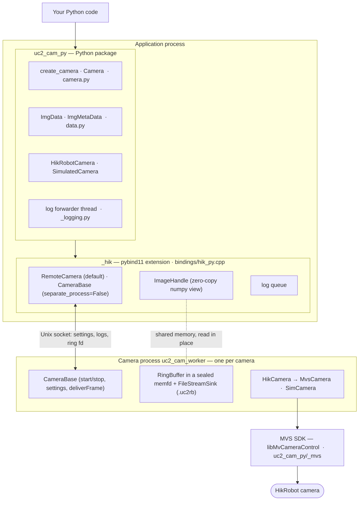
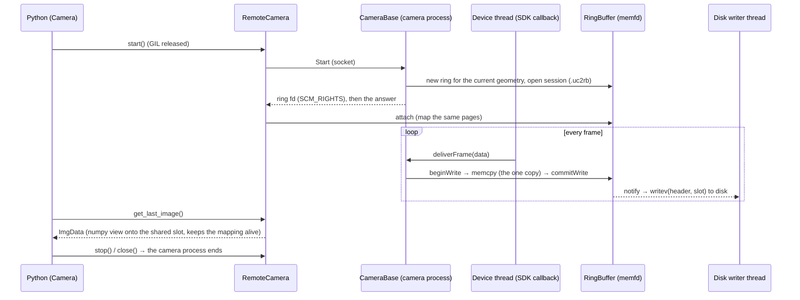

# UC2_cam_py

A Python camera interface for UC2 projects, built on a C++ core with a ring
buffer, recording to disk and zero-copy image access.

## Scope

- **Python interface** (`uc2_cam_py`): open a camera with `create_camera()`,
  set exposure / frame rate / gain / binning / ROI, start and stop acquisition,
  read images as numpy arrays without copying, record to disk. The full
  specification is [Docs/UC2_cam_py_interface.md](Docs/UC2_cam_py_interface.md).
- **Vendors:** HikRobot cameras (GigE Vision and USB3 Vision, via the MVS SDK that ships
  with the project in `External/hik/MVS`) and a **simulated camera** for development and
  tests without hardware.
- **One process per camera** (default): each camera runs in a process of its own
  (`uc2_cam_worker`), so several cameras spread over the CPU cores by themselves and a
  crashing camera SDK cannot take your application down. Images are still read zero-copy,
  from shared memory.
- **C++ core** (`hikcam_core`): ring buffer
  ([Docs/RingBuff_REF.md](Docs/RingBuff_REF.md)), camera abstraction, camera process and its
  protocol, logging.
- **Tools:** a terminal capture tool (`HikStandAlone`), a ring-buffer example,
  profiling and sanitizer setups ([Docs/Tooling.md](Docs/Tooling.md)).

## Project layout

```
UC2_cam_py/
├── core/                     # the C++ library
│   ├── CMakeLists.txt        #   builds hikcam_core (lib) and the Catch2 tests
│   ├── include/              #   headers
│   │   ├── CameraBase.h      #     vendor-neutral camera + ring-buffer acquisition
│   │   ├── HikCamera.h       #     HikRobot implementation (MVS SDK)
│   │   ├── SimCamera.h       #     simulated camera (walking Gaussian spot)
│   │   ├── UC2_RingBuff.h    #     ring buffer + disk streamer (heap or shared memory)
│   │   ├── RemoteCamera.h    #     a camera in its own process, seen from the application
│   │   ├── CamWorker.h       #     the camera process (serves one camera)
│   │   ├── CamIpc.h          #     messages between the two (Unix socket, fd passing)
│   │   ├── MvsCamera.h       #     thin MVS SDK wrapper (enumerate/open/nodes)
│   │   ├── CaptureApp.h      #     connection test shared by CLI + Python
│   │   ├── ImageWindow.h     #     minimal X11 preview window
│   │   ├── UC2Version.h      #     hik::version(), from the file VERSION
│   │   └── hikLog.h          #     logging with a replaceable sink
│   ├── src/                  #   library sources
│   ├── worker/               #   uc2_cam_worker: main() of the camera process
│   └── tests/                #   C++ unit tests (Catch2)
├── Examples/                 # programs built on the core (-DHIK_BUILD_EXAMPLES, default ON)
│   ├── HikStandalone.cpp     #   HikStandAlone: terminal capture tool (needs a camera)
│   └── RingBuffExample.cpp   #   ring-buffer walkthrough with simulated frames
├── bindings/
│   └── hik_py.cpp            # pybind11 module (_hik), low level
├── python/uc2_cam_py/        # the Python package
│   ├── camera.py             #   Camera + create_camera (the interface)
│   ├── data.py               #   ImgData, ImgMetaData
│   ├── hikrobot.py           #   HikRobot vendor class (+ model table)
│   ├── simulated.py          #   simulated vendor class
│   ├── _preview.py           #   live-view window behind create_camera(debug_window=True)
│   ├── _process.py           #   starts the camera process (separate_process=True)
│   ├── defaults.py           #   default values (later from config.yaml)
│   └── __main__.py           #   `python -m uc2_cam_py`: pick a camera, live view
├── tests/                    # pytest suite (Simulated always, HikRobot with -m hardware)
├── Docs/                     # interface spec, ring-buffer reference, tooling
├── CMakePresets.json         # build variants debug | profile | asan | tsan
├── pyproject.toml            # Python packaging (scikit-build-core + pybind11, uv)
├── VERSION                   # the version number, the only place it is written down
├── CHANGELOG.md              # what changed in which version
└── README.md
```

## Architecture



Acquisition runs entirely in C++ and never needs the GIL: the device thread
(SDK callback or simulation thread) copies each frame once into a ring slot;
Python reads slots as read-only numpy views; a writer thread streams the slots
to disk. By default all of that happens in a **camera process** per camera
(`create_camera(..., separate_process=True)`). The ring buffer of every session
is a memfd that the camera process hands to the application, which maps it, so
reading stays zero-copy. Settings are calls over a socket. If a camera process
dies, the camera is reported lost, images already read stay valid, and the other
cameras and the application carry on. With `separate_process=False` the same
C++ code runs in the application process instead.



## Requirements

- **The HikRobot MVS SDK — optional, no installation needed.** Put HikRobot's Linux packages
  (`MVS-<version>_Linux_<arch>_<date>.zip`, x86_64 and/or aarch64) into `External/hik/`
  and run `uv run fetch_mvs` once; see [External/hik/README.md](External/hik/README.md).
  **Without it** everything still builds - CMake warns - but without HikRobot support: only
  the `"Simulated"` camera is available, importing `uc2_cam_py` logs an ERROR saying so and
  why, `vendors()` lists only `"Simulated"`, and `create_camera(vendor="HikRobot")` (the
  default vendor) raises `RuntimeError`. After `fetch_mvs`, build again / reinstall the package.
  The same holds for an SDK that is there but does not fit: CMake compiles the code that uses
  the SDK and links against its library once at configure time (`core/cmake/MvsProbe.cmake`,
  cached until SDK or code change). The CMake switch `HIK_MVS` decides: `AUTO` (default: use
  the SDK if it is there and fits), `ON` (required: missing or unfit is an error), `OFF`
  (build without it).
- **Another SDK, e.g. from a package that depends on uc2_cam_py:** `MVS_ROOT` points the build
  at it instead of `External/hik/MVS`. If it is missing or does not fit, the build still
  succeeds without HikRobot support, and the import ERROR names the reason:

  ```toml
  # pyproject.toml of the depending package (uv)
  [tool.uv]
  config-settings-package = { uc2-cam-py = { "cmake.define.MVS_ROOT" = "/opt/MVS" } }
  ```
  The SDK is proprietary and therefore not in git. CMake uses only this copy (an
  `/opt/MVS` installation is ignored; `-DMVS_ROOT=/path` overrides it deliberately), and the
  installed Python package carries the runtime libraries in `uc2_cam_py/_mvs/`.
  Still needed once per machine, with `sudo`: the udev rule / usbfs memory for USB3
  cameras and the network settings for GigE — HikRobot's scripts for that land in
  `External/hik/MVS/scripts/`.
- A C++17 compiler, CMake ≥ 3.25, Ninja.
- For the Python package: [uv](https://docs.astral.sh/uv/) and Python 3.12
  (uv installs it automatically from `.python-version`).
- **For the preview window:** the X11 development headers. If they are missing:

  ```bash
  sudo dnf install libX11-devel        # Fedora / Nobara
  # or: sudo apt install libx11-dev    # Debian / Ubuntu
  ```

  Without them everything still builds and runs **headless**.

## Preparing CMake
- Initially CMake might fail, due to the absence of pybind11
- pybind11 should be installed to the .venv when running

```bash
uv sync
```

- All configure settings live in `CMakePresets.json`. The `debug` preset points
  CMake at the `.venv` interpreter and its pybind11; the other presets
  (`profile`, `asan`, `tsan`) skip the Python module and need no pybind11.
  Each preset builds into `build/<preset>`:

```bash
cmake --preset debug && cmake --build --preset debug
```

- VS Code (CMake Tools) picks the presets up automatically
  (`"cmake.useCMakePresets": "always"`); choose one in the status bar.
- Profiling (perf/hotspot, callgrind/kcachegrind) and sanitizer/valgrind runs
  are described in [Docs/Tooling.md](Docs/Tooling.md).

## Build & run — Python (uv)

```bash
uv sync                                        # creates .venv (Python 3.12), builds the extension
uv run main                                    # pick a camera, live view (= python -m uc2_cam_py)
uv run py_tests                                # pytest; extra arguments go to pytest
uv run c_tests                                 # build + CTest of the debug preset; arguments go to ctest
uv run all_tests                               # c_tests, then py_tests
```

`main`, `py_tests`, `c_tests` and `all_tests` come from the dev-only helper package
`tools/devtasks` (installed with the `dev` group, not part of the `uc2_cam_py` wheel).

After C++ changes reinstall the package (Python imports a *copy* of the module):
`uv pip install -e . --no-build-isolation`.

## Using the camera (Python)

```python
import logging
import uc2_cam_py
from uc2_cam_py import ImgData, ImgMetaData

logging.basicConfig(level=logging.INFO)          # the C++ core logs through Python logging

print(uc2_cam_py.list_devices())                 # connected HikRobot cameras (serials, transport)

with uc2_cam_py.create_camera(
    vendor="HikRobot",          # or "Simulated" (no hardware needed)
    connection_type="USB3",     # "USB3" | "GigE" | None
    serial=None, index=None,    # neither -> first camera
    buffer_size=16,             # images in the ring buffer
    image_file_path="~/UC2_recordings",
    store_image_data=True,      # stream every image to a .uc2rb file
) as cam:
    print(cam.pixel_count, cam.range_exposure_time_ms, cam.range_binning)

    cam.exposure_time_ms = 5.0          # clamped to the camera's range
    cam.frame_rate_per_sec = 30.0
    cam.gain_db = None                  # automatic gain
    cam.binning = 2
    cam.roi = (100, 100, 800, 600)      # (x, y, width, height), unbinned sensor pixels

    cam.start()
    img: ImgData | None = cam.get_last_image()
    if img is not None:
        frame = img.data                # read-only numpy view (H, W, C), no copy; C = 1 for mono
        result = frame.mean()
        if img.is_valid():              # not overwritten meanwhile -> result is consistent
            print(img.sequence, img.time_ns, result)
    meta: ImgMetaData = cam.get_image_info()
    cam.store_image_data = False        # stop writing to disk; the acquisition goes on
    print(cam.recording_file, meta.width, meta.height)
    cam.store_image_data = True         # ... and on again: a new .uc2rb file, no restart
    cam.stop()
```

Live view without extra dependencies — `debug_window=True` is the only way to open a
window. It shows the newest image until the camera is closed; without X11 an error is
logged and the camera works without it:

```python
import time

with uc2_cam_py.create_camera(vendor="Simulated", start_on_init=True, store_image_data=False,
                              debug_window=True) as cam:
    time.sleep(10)                           # the window runs on a thread of its own
```

`uc2_cam_py.list_cameras()` lists every camera that can be opened, over all vendors
(`CameraInfo`: vendor, model, serial, connection type); open one with
`create_camera(vendor=info.vendor, serial=info.serial)`.

Interactive live view: `uv run main` (or `uv run python -m uc2_cam_py`) lists the cameras, opens the one
whose index you type and shows each new image in the debug window (nothing is written
to disk). Enter, Ctrl+C or closing the window stops it:

```
Index  Name     Vendor     Connection  Serial
0      UC2-SIM  Simulated  -           SIM-0001
Camera index (0-0, Enter = quit):
```

Quick connection test of a HikRobot camera (grab, snapshot; no window):
`uc2_cam_py.run_connection_test(index=0, frames=100, snapshot="capture.png")`.
The MVS runtime libraries are located automatically; no `LD_LIBRARY_PATH` needed.

## Build & run — C++ standalone (Examples)

The terminal tool lives in `Examples/` and is built by the top-level project.
The `profile` preset (optimised, no Python module, so no pybind11 needed) is the
simplest way to get it:

```bash
cmake --preset profile
cmake --build --preset profile --target HikStandAlone
./build/profile/Examples/HikStandAlone   # interactive: list cameras, pick one, live preview
```

(The `debug` preset produces the same binary as `build/debug/Examples/HikStandAlone`.)

At configure time CMake reports which mode it built:

- `X11 found -> building with live preview window.`
- `... building HEADLESS (no preview window).` (install `libX11-devel` and
  rebuild to switch on the window)

Options:

```
HikStandAlone [options]

  -i, --index N       Open device N (skip the interactive prompt)
  -n, --frames N      Stop after N frames (default: 0 = run until Enter / window close)
  -s, --snapshot PATH Save the first grabbed frame to PATH (.bmp/.jpg/.png/.tif)
      --no-display    Do not open a preview window (headless)
  -h, --help          Show this help
```

```bash
# Open camera 0, grab 100 frames, save the first as PNG
./build/profile/Examples/HikStandAlone --index 0 --frames 100 --snapshot capture.png

# Headless single grab (writes snapshot.png by default when no window)
./build/profile/Examples/HikStandAlone --index 0 --frames 1 --no-display
```

When no preview window is available and you did not pass `--snapshot`, the
first frame is written to `snapshot.png` so you can still inspect the image.

## Tests

**Python** (pytest). Most interface tests run twice: against the simulated
camera (always) and against a HikRobot camera (marker `hardware`, skipped when
none is connected). `display` tests open a preview window and are skipped
without a display.

```bash
uv run all_tests                  # C++ and Python, both always run; exit code != 0 if one fails
uv run py_tests                   # all pytest tests (hardware/display skip themselves)
uv run py_tests -m "not hardware" # everything that needs no camera
uv run py_tests -m hardware       # the same checks on a real camera
UC2_DISPLAY_SECONDS=30 uv run py_tests -m display   # live view in the debug window, longer
```

**C++** (Catch2 via CTest — every preset builds the tests):

```bash
uv run c_tests                    # configure if needed, build and test the debug preset
uv run c_tests -R waitForFrame    # arguments go to ctest
cmake --preset debug && cmake --build --preset debug && ctest --preset debug   # the same by hand
ctest --preset asan    # same suite under ASan + UBSan + LSan (after building that preset)
ctest --preset tsan    # same suite under TSan
```

Without presets, the core alone: `cmake -S core -B build/core -DHIK_BUILD_TESTS=ON`
(off by default there).

The C++ unit tier (ring buffer, camera helpers, logging, the simulated camera
end to end, error-code mapping, headless `ImageWindow`, SDK init) needs no
camera. The `[hardware]` tests (built by the presets) open a HikRobot camera
through `MvsCamera` and `HikCamera` and SKIP themselves when none is connected.

## Versioning

`uc2_cam_py` follows [Semantic Versioning](https://semver.org/): `MAJOR.MINOR.PATCH`.

- **MAJOR** for a change that breaks existing users: the Python interface
  (`Docs/UC2_cam_py_interface.md`) or a `.uc2rb` file layout that older readers cannot read.
- **MINOR** for new functions, options or vendors that leave existing code working.
- **PATCH** for bug fixes.

The number is written down in one place only, the file [`VERSION`](VERSION). Everything else
derives from it:

| Where | How it gets there |
|---|---|
| package metadata (`pip show`, wheel name) | `pyproject.toml` reads `VERSION` (`[tool.scikit-build.metadata.version]`) |
| C++ `hik::version()`, `_hik.__version__` | `core/cmake/UC2Version.cmake` reads `VERSION`; only `core/src/Version.cpp` sees it |
| `uc2_cam_py.__version__` | taken from `_hik`, so it is the version of the C++ code actually loaded |
| `uc2_cam_worker --version` | the camera process; `create_camera` refuses one of another version |
| every recording | `softwareVersion` in the `.uc2rb` header and the `.json` sidecar, `ImgMetaData.software_version` |

A build picks up a changed `VERSION` by itself (CMake re-configures, uv rebuilds).

**Releasing a version:**

1. Set the new number in `VERSION`.
2. Add a section to [`CHANGELOG.md`](CHANGELOG.md) (move the "Unreleased" entries there).
3. `uv pip install -e . --no-build-isolation`, then `uv run all_tests`.
4. Commit, then tag the commit: `git tag -a vX.Y.Z -m "uc2_cam_py X.Y.Z"`.

## Debugging the C++ code from VS Code

`.vscode/launch.json` has two configurations:

| Configuration | Debugger | Breakpoints that work |
|---|---|---|
| *Debug test.py* | debugpy | Python only |
| *Debug C++ (python -m uc2_cam_py)* | gdb (cppdbg) | C++ only |

The C++ one launches `.venv/bin/python -m uc2_cam_py` under gdb, so breakpoints in
`core/src/*.cpp` and `bindings/hik_py.cpp` are hit through the whole call chain
(pybind11 → `CameraBase`/`HikCamera` → `MvsCamera`). A breakpoint stays "unverified" until
`import uc2_cam_py` loads the extension, then gdb resolves it — that is expected.

**Cameras run in their own process by default.** Under gdb the configuration reaches the
application side (bindings, `RemoteCamera`); `CameraBase`, `HikCamera`, the ring buffer's
producer and the disk writer run in `uc2_cam_worker`. To debug those, either open the camera
with `separate_process=False` (or set `uc2_cam_py.defaults.SEPARATE_PROCESS = False` first),
or attach a second debugger to the camera process: `gdb -p <camera.process_id>`.

**The catch: `cmake --build --preset debug` alone is not enough.** Python does not import
the `_hik*.so` from the build tree. The editable install puts a meta path finder
at `sys.meta_path[0]` that hard-maps `uc2_cam_py._hik` to a *copy* under
`.venv/lib/python3.12/site-packages/uc2_cam_py/`, so `PYTHONPATH` cannot redirect
it either. That copy is built `Release` and **stripped** — gdb finds no symbols
in it.

Rebuild it as a Debug build instead:

```bash
SKBUILD_CMAKE_BUILD_TYPE=Debug uv pip install -e . --no-build-isolation
```

This is what the `uc2_cam_py: Debug-Build (editable reinstall)` task in
`.vscode/tasks.json` runs, and the C++ configuration invokes it as a
`preLaunchTask` — so every debug session picks up your latest C++ changes.
`Debug` also disables stripping on its own (scikit-build-core only strips for
`Release`/`MinSizeRel`), so no extra flag is needed. Verify with:

```bash
file .venv/lib/python3.12/site-packages/uc2_cam_py/_hik.cpython-312-*.so
# want: "with debug_info, not stripped"
```

To go back to an optimised module, reinstall without the variable:
`uv pip install -e . --no-build-isolation`.

For problems that do not involve Python at all, debugging
`build/debug/Examples/HikStandAlone` directly is simpler — the launch
configuration "Debug C++ (CMake launch target)" debugs whichever target is
selected in the CMake Tools status bar, in the active preset.

## Notes / troubleshooting

- **No cameras found**
  - GigE: the camera and your network card must be in the same subnet. HikRobot's
    `Ip_Configurator` (part of the full MVS package, not of `External/hik/MVS`) checks and
    assigns the camera IP.
  - USB3: 
  1. correct camera installation
      - Camera should be shown in lsusb
      - `External/hik/MVS` contains `include/` and `lib/64` (or `lib/aarch64`) — else run `uv run fetch_mvs`
  2. Usb rights are set correctly (or run `sudo External/hik/MVS/scripts/set_usb_priority.sh`)
      - ls -l /dev/bus/usb/*/* | grep -i -B0 rw-rw-rw-
      - if this doesn't show anything
        - /etc/udev/rules.d/99-mvs-usb.rules
        - Add line: SUBSYSTEM=="usb", ATTRS{idVendor}=="2bdf", MODE="0666"
        - sudo udevadm control --reload-rules
        - sudo udevadm trigger
        - Unplug camera and plug again

  3. make sure the USB filesystem buffer is large enough; the SDK ships
    `sudo External/hik/MVS/scripts/set_usbfs_memory_size.sh` for that.
- **Verify against Hik's own tool**: the MVS GUI client (full MVS installation, optional)
  is handy to confirm the camera is reachable independently of this tool.
- **The MVS installer's environment** (`LD_LIBRARY_PATH=/opt/MVS/lib/...`, `MVCAM_*`,
  `ALLUSERSPROFILE` in `~/.bashrc`/`~/.profile`) is no longer needed and does not interfere:
  the programs carry a DT_RPATH to their SDK, and the Python package sets the SDK variables
  for its own process. Remove those lines if no other software uses `/opt/MVS`.
- The camera runs with `TriggerMode = Off` (free-run); the `trigger` setting is a
  placeholder for now.
- **`uv run …` fails with "No such file or directory" after moving or renaming the
  project directory:** the scripts in `.venv/bin` still point to the old path. Recreate the
  venv: `rm -rf .venv && uv sync`. Build trees configured before the move need
  `cmake --preset <name> --fresh` (and removing `build/<name>/_deps/catch2-subbuild`).


# FAQ

## What's the info in "lost_packets"?

lost_packets` isn't an action — it's a **read-only diagnostic counter** attached to each frame. It reports **how many transport packets were lost while that specific frame was being transferred from the camera to the host**.

It comes straight from the SDK's per-frame metadata (`MV_FRAME_OUT_INFO_EX.nLostPacket`).
The previous `Frame.lost_packets` property was removed together with the old
`Grabber` API; the new interface does not expose it yet (a candidate for the
per-frame header).

### What it means practically

A camera image is transmitted in many packets (very much a GigE Vision concept, also relevant on USB3). If some don't arrive, that count is non-zero and **the frame is likely incomplete/corrupted** (missing rows or garbled regions).

- `lost_packets == 0` → the frame arrived intact (the normal case).
- `lost_packets > 0` → a transfer problem for *that* frame. Common causes: network congestion, marginal cabling, the host not draining fast enough, or (on GigE) a too-small stream packet size / no jumbo frames. Pair it with gaps in `frame_num` to detect dropped frames.

So it's a **health/quality signal you can monitor**, not something that changes behavior. Typical use: log or check it, and if it's consistently non-zero on a GigE camera, increase the stream packet size (jumbo frames / `GevSCPSPacketSize`), improve the link, or lower the frame rate.

For your monochrome USB3 camera (MV-CA023-10UM) you'd normally expect it to stay 0; a persistently rising value would point at a USB bandwidth/cabling issue.

One caveat: it reflects packet loss the SDK is aware of at the transport layer — treat it as an indicator, not a guarantee that a 0 means bit-perfect data.

## Is the frame rate setting a native setting of the HIK Camera?

It's a **native camera setting** — real hardware/firmware frame-rate control, not client-side frame filtering.

`cam.frame_rate_per_sec = fps` writes the camera's own GenICam nodes ([HikCamera.cpp](core/src/HikCamera.cpp)):

```cpp
setBoolNode("AcquisitionFrameRateEnable", true);   // let firmware regulate the rate
setFloatNode("AcquisitionFrameRate", fps);         // target rate, timed by the sensor
```

There is **no software throttling** anywhere. The acquisition path is strictly `OneByOne` — every frame the camera produces is copied into the ring buffer; nothing is dropped or sampled to hit a rate.

### What the camera actually does
- `AcquisitionFrameRateEnable = true` switches the sensor from free-running at its maximum to **firmware-regulated timing**; it paces exposures/readouts to hit your target. With it `false`, the camera runs as fast as the current exposure/readout allow.
- `AcquisitionFrameRate` is a **target/upper bound**, hardware-timed — so it's precise and low-jitter, and it genuinely reduces the data the camera sends (less bandwidth/CPU), which software filtering could never do.

### Important caveat: it's bounded by physics
The requested rate can't exceed what **exposure time + sensor readout + ROI + interface bandwidth** allow. Example: a 50 ms exposure caps you near ~20 fps no matter what you request — ask for 30 and the camera silently regulates to what's achievable.

`cam.frame_rate_per_sec = None` removes the limit; reading `frame_rate_per_sec` then returns the read-only `ResultingFrameRate` node, i.e. what the camera *actually* delivers given the current exposure/ROI. With a limit set, it returns the configured target.