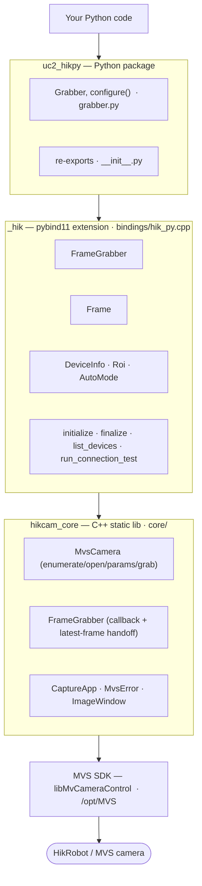
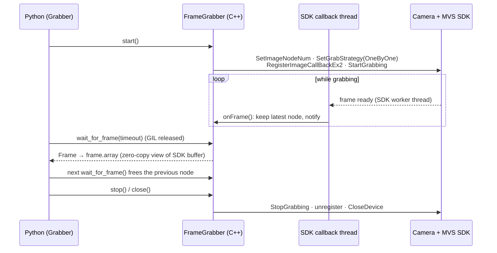

# UC2_pyCams

An interface in Python for using the HIK Camera in UC2 Projects

## Scope

A small test tool for **HikRobot / MVS** industrial cameras (GigE Vision and
USB3 Vision), available both as a **C++ terminal application** and as a
**Python package** (via pybind11). It

- enumerates the connected cameras,
- opens one (by index, interactively or via `--index`),
- streams frames in continuous (free-run) mode,
- prints per-frame info (size, length, pixel format) to the terminal,
- shows the **live image in a simple window** (when built with X11), and
- saves a **snapshot** to disk.  (to be depricated!)

It is built directly on the SDK installed at `/opt/MVS`
(`libMvCameraControl`). The live preview uses the SDK's own renderer
(`MV_CC_DisplayOneFrameEx2`), so no pixel-format conversion or OpenCV is
needed — the SDK draws Mono/Bayer/RGB frames into the window for you.

## Project layout

```
UC2_HIKpy/
├── core/                     # the C++ library + standalone terminal app
│   ├── CMakeLists.txt        #   builds hikcam_core (lib) and HikStandAlone (app)
│   ├── include/              #   headers
│   │   ├── CaptureApp.h      #     capture session shared by CLI + Python
│   │   ├── MvsCamera.h       #     camera wrapper (enumerate/open/grab/display/save)
│   │   ├── ImageWindow.h     #     minimal X11 preview window (opaque, X11-free API)
│   │   └── MvsError.h        #     SDK error-code -> text
│   ├── src/                  #   sources (HikStandalone.cpp is the CLI; rest is the lib)
│   └── tests/                #   C++ unit tests (Catch2; -DHIK_BUILD_TESTS=ON)
├── bindings/
│   └── hik_py.cpp            # pybind11 module (_hik)
├── python/uc2_hikpy/         # the Python package
│   ├── __init__.py           #   initialises the SDK on import
│   └── __main__.py           #   `python -m uc2_hikpy` CLI
├── tests/test_hik.py         # pytest suite (+ runnable manual smoke script)
├── CMakeLists.txt            # top-level build (Python extension) for scikit-build-core
├── pyproject.toml            # Python packaging (scikit-build-core + pybind11, uv)
├── .python-version           # pins Python to 3.12
└── README.md
```

## Architecture

The package is layered: thin Python management on top, all image handling in C++.



Frame acquisition is event-driven and zero-copy: the SDK fills its own buffer
nodes and calls back on a worker thread; Python pulls the latest one with the
GIL released and receives a numpy view that aliases the SDK buffer.



## Requirements

- The MVS SDK, commonly installed at `/opt/MVS`.
- A C++14 compiler, CMake ≥ 3.15, `make`/`ninja`.
- For the Python package: [uv](https://docs.astral.sh/uv/) and Python 3.12 or higher
  (uv installs it automatically from `.python-version`).
- **For the preview window:** the X11 development headers (already installed
  here). If they are ever missing, install them once:

  ```bash
  sudo dnf install libX11-devel        # Fedora / Nobara
  # or: sudo apt install libx11-dev    # Debian / Ubuntu
  ```

  Without them everything still builds and runs **headless** — it grabs frames
  and writes a snapshot to disk instead of showing a window.

## Preparing CMake
- Initially CMake might fail, due to the absence of pybind11
- pybind11 should be installed to the .venv when running

```bash
uv sync
```

- if you are using vscode, just add the following to the .vscode/settings.json (make sure the paths are correct)

```json
// .vscode/settings.json
{
  "cmake.environment": {
    "VIRTUAL_ENV": "${workspaceFolder}/.venv",
    "PATH": "${workspaceFolder}/.venv/bin:${env:PATH}"
  },
  "cmake.configureSettings": {
    "Python_EXECUTABLE": "${workspaceFolder}/.venv/bin/python",
    "pybind11_DIR": "${workspaceFolder}/.venv/lib/python3.12/site-packages/pybind11/share/cmake/pybind11"
  }
}
```

## Build & run — Python (uv)

```bash
uv sync                              # creates .venv (Python 3.12), builds the extension
uv run pytest                        # runs the unit tests (no camera required)
uv run python tests/test_hik.py      # manual smoke run: lists cameras and starts a capture
```

From Python:

```python
import uc2_hikpy

for i, dev in enumerate(uc2_hikpy.list_devices()):
    print(i, dev)

# Quick connection test (index / frames / snapshot / display are all optional).
# For real acquisition use Grabber (see below).
uc2_hikpy.run_connection_test(index=0, frames=50, snapshot="snapshot.png", display=True)
```

`uv run python -m uc2_hikpy --index 0 --frames 100 --snapshot capture.png`
runs the same connection test from the command line. The MVS runtime libraries
(including the renderer) are located automatically, so you do **not** need to
export `LD_LIBRARY_PATH`.

## Continuous grabbing (Python)

For live streaming, `Grabber` runs acquisition on an SDK worker thread and hands
Python the **latest** frame as a **zero-copy** numpy view. There is intentionally
**no ring buffer here** — an indexable history is provided by a separate external
package; this layer exposes only the most recent frame plus its handle/size so
that ring can ingest it.

```python
from uc2_hikpy import Grabber

with Grabber(index=0, node_num=5) as g:      # opens + starts; stops + closes on exit
    for frame in g.frames(timeout_ms=1000):
        img = frame.array                    # zero-copy view: (H, W) or (H, W, 3) uint8
        # frame.address / frame.nbytes / frame.width / frame.height / frame.pixel_format
        # feed the future external ring, e.g. ring.push(frame.address, frame.nbytes)
        if some_condition:
            break
```

Key points:

- **Acquisition model:** event-driven callback (`MV_CC_RegisterImageCallBackEx2`)
  on an SDK-internal thread, using the **OneByOne** grab strategy (ordered frames).
- **SDK buffer nodes:** the SDK's internal pool depth is set with
  `MV_CC_SetImageNodeNum` (default 1; some cameras 3). `Grabber(node_num=...)`
  raises it for double/triple buffering (clamped to ≥ 3).
- **Zero-copy contract:** `frame.array` aliases SDK-owned memory and is valid
  **only until the next `wait_for_frame()`** call. Call `frame.copy()` to keep an
  independent array.
- **No frames lost while the consumer keeps up.** `g.frames_dropped` counts frames
  superseded before they were read (expected ~0 with a fast consumer).

### Parameters (exposure, gain, frame rate, ROI)

Get/set are available in C++ (`hik::MvsCamera` / `hik::FrameGrabber`) and Python
(`Grabber` / the underlying `FrameGrabber`). Units: **exposure = µs, gain = dB,
frame rate = fps**.

```python
from uc2_hikpy import Grabber, AutoMode

with Grabber(index=0) as g:
    # Apply several at once (only what you pass is set; ROI is applied last):
    g.configure(exposure_us=5000, gain_db=2.0, fps=30, roi=(640, 480))

    # ...or individually:
    g.set_exposure_time(5000)          # switches auto-exposure Off
    g.set_gain(2.0)                    # switches auto-gain Off
    g.set_frame_rate(30)              # enables manual frame-rate control
    g.set_exposure_auto(AutoMode.Continuous)   # or let the firmware regulate

    print(g.get_exposure_time(), g.get_gain(), g.get_resulting_frame_rate())
    print("sensor:", g.get_sensor_size(), "roi:", g.get_roi())

    frame = g.wait_for_frame()         # frame.array.shape now matches the ROI
```

Notes:

- **Exposure / gain / frame rate change live** while grabbing.
- **ROI does not invalidate zero-copy.** `frame.array` is rebuilt from each frame's
  own dimensions, so a smaller ROI just yields a smaller zero-copy view. The SDK
  only allows ROI changes while stopped, so `set_roi()` **briefly stops and restarts**
  the stream automatically. Requested ROI values are clamped and aligned to the
  camera's increment grid (width/height step is typically 16).
- Setting a manual exposure/gain switches the matching auto mode Off so the value
  takes effect; use `set_exposure_auto()` / `set_gain_auto()` for firmware control.

## Python API reference (`_hik` bindings)

Everything below is exposed by the compiled `_hik` module and re-exported from
`uc2_hikpy`. Units: exposure = µs, gain = dB, frame rate = fps.

**Module-level functions**

| Function | Returns | Description |
|---|---|---|
| `initialize()` | `bool` | Initialise the MVS SDK (done automatically on `import uc2_hikpy`). |
| `finalize()` | `None` | Finalise the SDK (registered at interpreter exit). |
| `list_devices()` | `list[DeviceInfo]` | Enumerate connected GigE/USB3 cameras. |
| `run_connection_test(index=-1, frames=0, snapshot="", display=True)` | `int` | Quick connection test: grab a few frames / save a snapshot. `0` ok, `2` no camera, `1` error. |

**`DeviceInfo`** — read-only: `transport`, `model_name`, `serial`, `user_name`, `ip` (all `str`).

**`Frame`** — one grabbed image (zero-copy; valid until the next `wait_for_frame()`):

| Member | Type | Description |
|---|---|---|
| `array` | `np.ndarray` | Zero-copy view: `(H, W)` mono or `(H, W, 3)` RGB/BGR `uint8` (else flat bytes). |
| `copy()` | `np.ndarray` | Independent, owning copy safe to keep. |
| `width`, `height` | `int` | Frame dimensions. |
| `pixel_format` | `int` | MvGvspPixelType value. |
| `frame_num` | `int` | Device frame/sequence number. |
| `timestamp` | `int` | Host timestamp. |
| `lost_packets` | `int` | Packets lost for this frame. |
| `nbytes`, `itemsize` | `int` | Byte length / channel sample size. |
| `address` | `int` | Buffer address (hand to an external ring). |

**`FrameGrabber`** — continuous grabber (the `Grabber` wrapper adds `configure()`, `frames()` and context-manager support on top of these):

| Method / property | Returns | Description |
|---|---|---|
| `open(index)` | `bool` | Enumerate and open device `index`. |
| `set_node_num(n)` | `None` | SDK buffer-node depth (≥ 3), before `start()`. |
| `start()` / `stop()` / `close()` | `bool` / `None` / `None` | Begin / end grabbing; close the device. |
| `wait_for_frame(timeout_ms=1000)` | `Frame \| None` | Block for the latest frame (GIL released). |
| `is_running`, `frames_received`, `frames_dropped` | `bool`, `int`, `int` | Live status counters. |
| `payload_size`, `width`, `height`, `pixel_format` | `int` | Current stream geometry. |
| `set_exposure_time(us)` / `get_exposure_time()` / `get_exposure_time_range()` | `bool` / `float` / `tuple` | Exposure (µs). |
| `set_gain(db)` / `get_gain()` / `get_gain_range()` | `bool` / `float` / `tuple` | Gain (dB). |
| `set_frame_rate(fps)` / `get_frame_rate()` / `get_resulting_frame_rate()` / `get_frame_rate_range()` | `bool` / `float` / `float` / `tuple` | Frame rate (fps). |
| `set_exposure_auto(mode)` / `get_exposure_auto()` | `bool` / `AutoMode` | Auto-exposure mode. |
| `set_gain_auto(mode)` / `get_gain_auto()` | `bool` / `AutoMode` | Auto-gain mode. |
| `set_roi(width, height, offset_x=0, offset_y=0)` | `bool` | Set ROI (auto stop/restart; zero-copy preserved). |
| `get_roi()` / `get_sensor_size()` | `Roi` / `tuple[int, int]` | Current ROI / full sensor size. |

**`Roi`** — read-only: `width`, `height`, `offset_x`, `offset_y` (`int`).
**`AutoMode`** — enum: `Off`, `Once`, `Continuous`.

## Full example

List devices, start the first camera, read its info, set the exposure, take a
zero-copy frame, then shut everything down.

```python
import uc2_hikpy
from uc2_hikpy import Grabber

# 1. List connected cameras (the SDK is initialised automatically on import).
devices = uc2_hikpy.list_devices()
if not devices:
    raise SystemExit("no HikRobot/MVS camera found")

# 2. Device info.
info = devices[0]
print(f"Using {info.model_name}  (SN {info.serial}, {info.transport})")

# 3. Open + start the first device. The context manager opens & starts on entry
#    and stops & closes on exit (equivalent to cam.start() ... cam.close()).
with Grabber(index=0, node_num=5) as cam:

    # 4. Set the exposure time (microseconds); auto-exposure is switched Off.
    cam.set_exposure_time(5000)
    print("exposure:", cam.get_exposure_time(), "us")

    # 5. Grab the latest frame and access it zero-copy.
    frame = cam.wait_for_frame(timeout_ms=1000)
    if frame is not None:
        img = frame.array               # numpy view: (H, W) or (H, W, 3) uint8
        print(f"frame #{frame.frame_num}: {img.shape} @ {hex(frame.address)}")
        # img aliases SDK memory and is valid until the next wait_for_frame();
        # use frame.copy() if you need to keep it.

# 6. Leaving the 'with' block has stopped grabbing and closed the device;
#    the SDK is finalised automatically at interpreter exit.
```

## Build & run — C++ standalone (core)

```bash
cmake -S core -B build/core
cmake --build build/core -j
./build/core/HikStandAlone           # interactive: list cameras, pick one, live preview
```

At configure time CMake reports which mode it built:

- `X11 found -> building with live preview window.`
- `... building HEADLESS (no preview window).` (install `libX11-devel` and
  rebuild to switch on the window)

Options:

```
HikStandAlone [options]

  -i, --index N       Open device N (skip the interactive prompt)
  -n, --frames N      Stop after N frames (default: 0 = run until Enter / window close)
  -s, --snapshot PATH Save the first grabbed frame to PATH (.bmp/.jpg/.png/.tif)
      --no-display    Do not open a preview window (headless)
  -h, --help          Show this help
```

```bash
# Open camera 0, grab 100 frames, save the first as PNG
./build/core/HikStandAlone --index 0 --frames 100 --snapshot capture.png

# Headless single grab (writes snapshot.png by default when no window)
./build/core/HikStandAlone --index 0 --frames 1 --no-display
```

When no preview window is available and you did not pass `--snapshot`, the
first frame is written to `snapshot.png` so you can still inspect the image.

## Tests

**Python** (pytest — no camera needed for the unit tests):

```bash
uv run pytest                 # import + list_devices smoke tests
uv run pytest -m hardware     # also runs the capture test (needs a camera)
```

**C++** (Catch2 via CTest — off by default, enable with `-DHIK_BUILD_TESTS=ON`):

```bash
cmake -S core -B build/core -DHIK_BUILD_TESTS=ON
cmake --build build/core -j
ctest --test-dir build/core --output-on-failure
```

The C++ unit tier (error-code mapping, capture options, headless `ImageWindow`,
SDK init/enumerate, pixel-format mapping, `FrameGrabber` lifecycle) needs no
camera. Add `-DHIK_ENABLE_HARDWARE_TESTS=ON` to also build the `[hardware]`
integration tests, which open the first device and grab a frame both directly
and through `FrameGrabber` (and SKIP themselves when no camera is connected).

## Notes / troubleshooting

- **No cameras found**
  - GigE: the camera and your network card must be in the same subnet. Use
    `/opt/MVS/bin/Ip_Configurator` to check/assign the camera IP.
  - USB3: 
  1. correct camera installation
      - Camera should be shown in lsusb
      - Camera root dir is /opt/MVS and that contains /include and /lib
  2. Usb rights are set correctly
      - ls -l /dev/bus/usb/*/* | grep -i -B0 rw-rw-rw-
      - if this doesn't show anything
        - /etc/udev/rules.d/99-mvs-usb.rules
        - Add line: SUBSYSTEM=="usb", ATTRS{idVendor}=="2bdf", MODE="0666"
        - sudo udevadm control --reload-rules
        - sudo udevadm trigger
        - Unplug camera and plug again

  3. make sure the USB filesystem buffer is large enough; the SDK ships
    `sudo /opt/MVS/bin/set_usbfs_memory_size.sh` for that.
- **Verify against Hik's own tool**: `/opt/MVS/bin/MVS` is the full GUI client
  and is handy to confirm the camera is reachable independently of this tool.
- The tool sets `TriggerMode = Off` (free-run). To test hardware triggering,
  extend `MvsCamera::open()` accordingly.


# FAQ

## What's the info in "lost_packets"?

lost_packets` isn't an action — it's a **read-only diagnostic counter** attached to each frame. It reports **how many transport packets were lost while that specific frame was being transferred from the camera to the host**.

It comes straight from the SDK's per-frame metadata (`MV_FRAME_OUT_INFO_EX.nLostPacket`), which we surface unchanged:
- populated in [FrameGrabber.cpp](core/src/FrameGrabber.cpp) — `v.lostPacket = f.stFrameInfo.nLostPacket;`
- exposed as `Frame.lost_packets` in [hik_py.cpp](bindings/hik_py.cpp)

### What it means practically

A camera image is transmitted in many packets (very much a GigE Vision concept, also relevant on USB3). If some don't arrive, that count is non-zero and **the frame is likely incomplete/corrupted** (missing rows or garbled regions).

- `lost_packets == 0` → the frame arrived intact (the normal case).
- `lost_packets > 0` → a transfer problem for *that* frame. Common causes: network congestion, marginal cabling, the host not draining fast enough, or (on GigE) a too-small stream packet size / no jumbo frames. Pair it with gaps in `frame_num` to detect dropped frames.

So it's a **health/quality signal you can monitor**, not something that changes behavior. Typical use: log or check it, and if it's consistently non-zero on a GigE camera, increase the stream packet size (jumbo frames / `GevSCPSPacketSize`), improve the link, or lower the frame rate.

For your monochrome USB3 camera (MV-CA023-10UM) you'd normally expect it to stay 0; a persistently rising value would point at a USB bandwidth/cabling issue.

One caveat: it reflects packet loss the SDK is aware of at the transport layer — treat it as an indicator, not a guarantee that a 0 means bit-perfect data.

## Is the frame rate setting a native setting of the HIK Camera?

It's a **native camera setting** — real hardware/firmware frame-rate control, not client-side frame filtering.

`set_frame_rate(fps)` writes the camera's own GenICam nodes ([MvsCamera.cpp](core/src/MvsCamera.cpp)):

```cpp
setBoolNode("AcquisitionFrameRateEnable", true);   // let firmware regulate the rate
setFloatNode("AcquisitionFrameRate", fps);         // target rate, timed by the sensor
```

There is **no software throttling** anywhere in the grabber. The acquisition path is strictly `OneByOne` — every frame the camera produces is delivered; nothing is dropped or sampled to hit a rate. (`frames_dropped` counts only frames superseded because *your consumer* was slow, which is unrelated to rate control.)

### What the camera actually does
- `AcquisitionFrameRateEnable = true` switches the sensor from free-running at its maximum to **firmware-regulated timing**; it paces exposures/readouts to hit your target. With it `false`, the camera runs as fast as the current exposure/readout allow.
- `AcquisitionFrameRate` is a **target/upper bound**, hardware-timed — so it's precise and low-jitter, and it genuinely reduces the data the camera sends (less bandwidth/CPU), which software filtering could never do.

### Important caveat: it's bounded by physics
The requested rate can't exceed what **exposure time + sensor readout + ROI + interface bandwidth** allow. Example: a 50 ms exposure caps you near ~20 fps no matter what you request — ask for 30 and the camera silently regulates to what's achievable.

That's exactly why I also exposed **`get_resulting_frame_rate()`** (the read-only `ResultingFrameRate` node): `get_frame_rate()` returns what you *asked for*, while `get_resulting_frame_rate()` returns what the camera will *actually* deliver given the current exposure/ROI. If they differ, exposure (or bandwidth) is the limiter — lower the exposure to reach a higher rate.